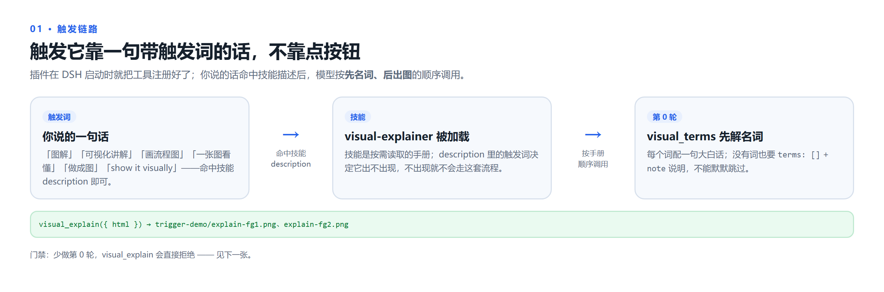
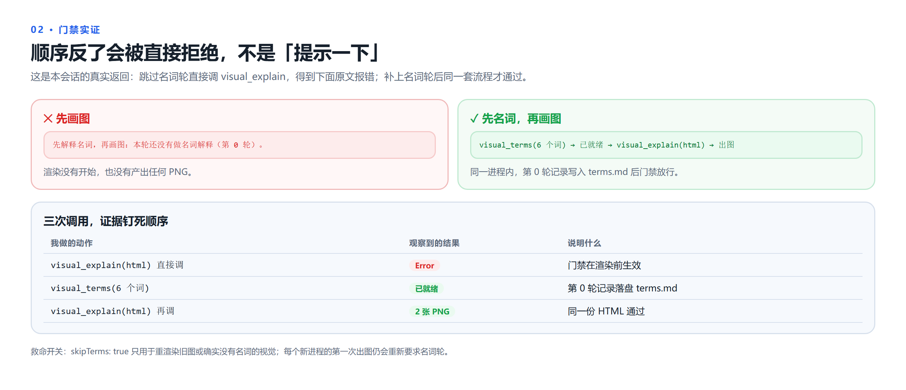
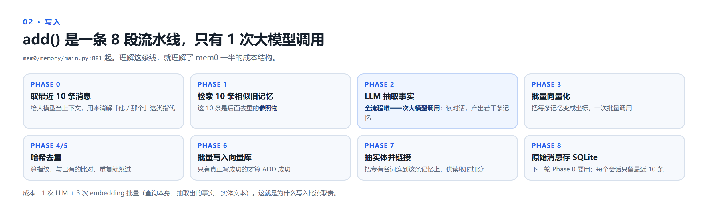
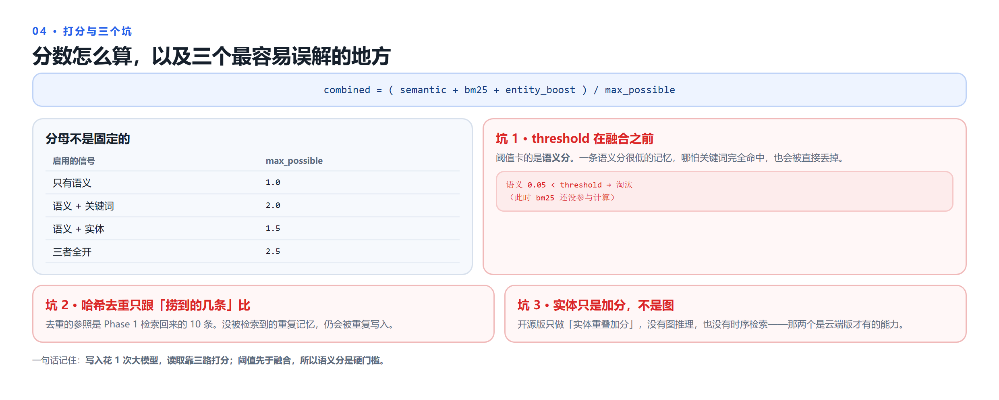

# dsh-visual-explainer

[](https://github.com/biubiuandmiaomiao/dsh-visual-explainer/actions/workflows/test.yml)
[](LICENSE)

给 [DeepSeek Harness](https://github.com/deepseek-ai) 的讲解插件：**先把专业/技术名词讲成人话，再把讲解画成一张张 PNG 卡片**，或生成一页可点的离线 mermaid 交互页。

图能压缩信息，前提是读者认识图上的词。所以这个插件把顺序固定下来：

1. `visual_terms` 把名词逐个翻成大白话（一个词一句，可带类比与常见误解）；
2. `visual_explain` 才画图，图上的节点/步骤与已解释的名词一一对应；
3. 顺序反了会被**门禁直接拒绝**，而不是悄悄画出一张没人看得懂的图。





## 四个工具

| 工具 | 作用 |
|---|---|
| `visual_terms` | **第 0 轮：先解释名词。** 把本次讲解里的专业/技术名词写成 `{ term, plain, context?, analogy?, pitfall? }`，返回一段可直接放进回答开头的 markdown，并落盘 `terms.md` / `terms.json` |
| `visual_explain` | **再画图。** 写入你给的 HTML，按 `<section id="fgN">` 逐张渲染成 PNG（先测真实高度再截图，图片底部没有多余留白），返回路径 |
| `visual_template` | 可选：写出起步模板（1240px 画布、语义配色、卡片隔离样式、「名词 → 图里在哪」示例卡、测高脚本） |
| `visual_interactive` | 另一种形态：生成**可点的离线交互讲解页**（左侧步骤条 + 右侧 mermaid 图 + 大白话）；`check` 用无头浏览器自检每一步的图能不能渲染 |

渲染走本机 **Chrome / Edge 的 headless 模式**：不装依赖、不联网。插件还注册了一份按需加载的技能手册（`skill.md`），把「把一张图讲成小白能懂」的完整流程与 mermaid 坑位写在其中。

## 真实产物

下面是本插件给 [mem0](https://github.com/mem0ai/mem0) 源码画的 add / search 流程卡片（4 张中的两张）：





## 快速开始

### 环境要求

- DeepSeek Harness 桌面版（插件是 host 侧 bundle，在 Windows 上验证；浏览器探测同时覆盖 macOS / Linux 常见路径）
- 本机安装 **Chrome 或 Edge**（渲染与自检都靠它）
- Node.js ≥ 20（跑测试、或独立使用命令行渲染器时需要）

### 安装

```powershell
git clone https://github.com/biubiuandmiaomiao/dsh-visual-explainer.git
cd dsh-visual-explainer
pwsh -File .\install.ps1            # 默认 link：源码改动下次重载生效
# 或：打包成 tgz 再装，和源码目录解耦
pwsh -File .\install.ps1 -Mode pack
```

脚本会自动找 pnpm（`-Pnpm` → `DSH_DESKTOP_PNPM` → DSH 内置运行时 → PATH），并把包选进 profile 的 `dsh.profile.bundles`。

**装完必须重启一次 DeepSeek Harness**：工具在进程启动时注册到 `ctx.tools`。（名词轮的「是否做过」记录是进程内的，重启后第一次画图会重新要求先解释名词——这是有意的。）

验证：

- 侧边栏 **Plugins** 里应能看到 `dsh-visual-explainer` 的开关；
- `%TEMP%\dsh-visual-explainer-status.json` 里 `pluginVersion`、`toolsRegistered`、`appliedAt` 应与本次启动一致；
- 让模型做一次「图解」，它应该能直接调用 `visual_terms`。

<details>
<summary>手动接线（不用 install.ps1）</summary>

在 profile 的 `package.json`（默认 `%USERPROFILE%\.dsh\profiles\desktop\package.json`）里：

```jsonc
{
  "dependencies": {
    "dsh-visual-explainer": "file:D:/path/to/dsh-visual-explainer"
  },
  "dsh": {
    "profile": {
      "bundles": ["@deepseek-ai/dsh-base", "dsh-visual-explainer"]
    }
  }
}
```

然后在 profile 目录执行 `pnpm install`。包内的 `cordis.patch.yml` 会插入插件行，不需要再手写 profile patch（手写过的话要删掉，否则会重复插入）。

</details>

## 配置

在 profile 的 `cordis.patch.yml` 里按行 id 覆盖（也可以直接改包内默认值）：

```yaml
- id: visual-explainer
  name: dsh-visual-explainer
  config:
    outDir: .dsh-visual   # 相对会话工作目录
    scale: 2              # 2 → 1240px 画布输出 2480px 宽
    width: 1240
    browser: ""           # 留空则自动找 Chrome / Edge
    maxCards: 12          # 单次渲染上限，防止误渲染几十张
    termsFirst: true      # true=画图前必须先做名词轮；false=关掉门禁
    explainerDir: .dsh-explain  # visual_interactive 的默认输出目录
```

## 用法（模型侧）

### 直接说

- 「用图解讲讲 X」
- 「一张图看懂 X」
- 「先解释这些名词，再画成图」
- 「把这张时序图讲成代码小白能懂，并做成可点的 mermaid 页」

话术命中技能描述后，模型会按手册顺序调用工具；也可以直接点名工具。

### 四步流水线

```js
// 1. 第 0 轮：名词
visual_terms({
  topic: 'mem0 的 add / search 流程',
  terms: [
    { term: 'Embedding', plain: '把一句话变成一串数字坐标，意思相近的坐标也相近' },
    { term: 'BM25', plain: '老式关键词打分：只认字面，不懂意思' }
  ]
});

// 2. 可选：写起步模板
visual_template({ path: 'explain.html' });

// 3. 出图（HTML 里每张卡是一个 <section id="fgN">，并带上测高脚本）
visual_explain({ html: '<!doctype html>…', outDir: 'figs' });

// 4. 或者：可点的交互页
visual_interactive({ action: 'scaffold', dir: 'explain', title: '看懂这个系统' });
// 改 explain/index.html 里的 const steps=[...]，然后：
visual_interactive({ action: 'check', dir: 'explain' });
// → 自检通过：14/14 张图渲染成功
```

名词轮没做就调 `visual_explain`，会得到明确的错误：

> 先解释名词，再画图：本轮还没有做名词解释（第 0 轮）。

确实没有名词要解释时：`visual_terms({ terms: [], note: '…' })`，或给 `visual_explain` 传 `skipTerms: true`（只建议用于重渲染旧图）。

### 卡片约定

- 一张卡 = 一个结论，id 必须是 `fg1`、`fg2`、`fg3`…（渲染器靠它识别并按编号排序）；
- 高度预算 ≈ 800px，超了就把内容拆到下一张；
- **必须保留测高脚本**（模板里已带）：它把可见 section 的最下沿写进 `document.title`，渲染器据此裁掉底部空白；不要改成 `documentElement.scrollHeight`，内容比视口矮时它会返回视口高度，所有图片都会变成同样尺寸并留白。

## 命令行单独使用（不装 DSH）

```powershell
node renderer.mjs --html explain.html --out figs --scale 2
node renderer.mjs --html explain.html --out figs --figs 1,3   # 只出某几张
node renderer.mjs --html explain.html --out figs --whole      # 整页一张长图
node renderer.mjs --html explain.html --out figs --height 900 # 跳过测高
```

## 交互页（`visual_interactive`）

| 交互 | 说明 |
|---|---|
| 左侧步骤条 | 点任意一步换图 + 换解释，当前步高亮并滚动跟随 |
| 上一步 / 下一步 / 自动播放 | 3 秒一步 |
| 键盘 | `←` `→` 切换，`空格` 播放/暂停 |
| 深链 | `index.html#s4` 打开即停在第 4 步 |
| 自检 | `index.html#selftest` 依次渲染全部图并输出结果（`check` 依赖它） |
| 源码折叠 | 每步可展开 mermaid 源码，复制去 mermaid.live |
| 离线 | 自带本地 `mermaid.min.js`，不联网 |

关键限制：**每一步要一张独立的小图**，不要让 mermaid 源码做「增量显示」——`alt` 没闭合会直接 parse 失败；`sequenceDiagram` 每条消息建议 ≤10 个汉字，否则窄泳道会强行断词并插 `-`。

## 目录结构

```
index.js                 # 插件入口：注册 4 个工具 + 技能手册
renderer.mjs             # 卡片渲染：测高 + 逐卡截图（Chrome/Edge headless）
lib/terms.mjs            # 名词轮的解析、去重、markdown 生成、门禁
lib/interactive.mjs      # 交互页 scaffold / 自检
assets/                  # mermaid.min.js、交互页模板
template.html            # visual_template 写出的起步模板
skill.md                 # 插件注册的技能手册
cordis.patch.yml         # bundle patch：插入插件行 + 默认配置
install.ps1              # 安装到 DSH profile
test/                    # node:test 测试（渲染 / 名词轮 / 门禁 / 交互页）
```

## 开发与测试

```powershell
node --check index.js
node --check renderer.mjs
node --check lib/terms.mjs
node --test              # 11 个测试：纯逻辑 + 真渲染
```

`test/render.test.js` 会真的把自带模板渲染到临时目录并校验 PNG 尺寸；`test/interactive.test.js` 会跑一遍页面自检。没有 Chrome/Edge 的机器上，依赖浏览器的测试会自动 skip，纯逻辑测试仍会运行。

CI 在 Ubuntu / Windows × Node 20 / 22 上跑同一套测试（见 [.github/workflows/test.yml](.github/workflows/test.yml)）。

## 故障排查

| 现象 | 检查 |
|---|---|
| 工具列表里没有 `visual_terms` / `visual_explain` | 重启 Harness；读 `%TEMP%\dsh-visual-explainer-status.json`：没有 `appliedAt` → 插件没加载；`toolsRegistered.visual_terms=false` → 看 `termsRegisterError` |
| 画图时报「先解释名词，再画图」 | 正常门禁：先调 `visual_terms`；确实没有名词就用 `terms: []` + `note`；旧图重渲染用 `skipTerms: true` |
| `visual_terms` 报「缺少 plain」 | 名词轮不允许只罗列名词：每个词补一句大白话 |
| 渲染失败 / 0 张图 | 状态文件的 `lastFailures`；多为找不到浏览器（设 `browser` 或 `CHROME_PATH`）或 HTML 里没有 `id="fgN"` |
| 每张图尺寸都一样且底部留白 | 测高脚本被改成了 `scrollHeight` |
| 多张卡挤进一张图 | 卡片隔离样式被删，或 id 不是 `fgN` |
| 中文变方框 | 用模板里的字体栈，别引入未安装的 web 字体 |
| 交互页白屏 | 必须用 `scaffold` 生成的页面（本地 `mermaid.min.js`）；不要从 CDN 引 |

## 许可证

[MIT](LICENSE) © 2026 biubiuandmiaomiao

打包的 `assets/mermaid.min.js` 是 [Mermaid](https://github.com/mermaid-js/mermaid)（MIT）的浏览器构建，用于离线渲染交互页；完整的第三方声明与许可证文本见 [THIRD_PARTY_NOTICES.md](THIRD_PARTY_NOTICES.md)。
